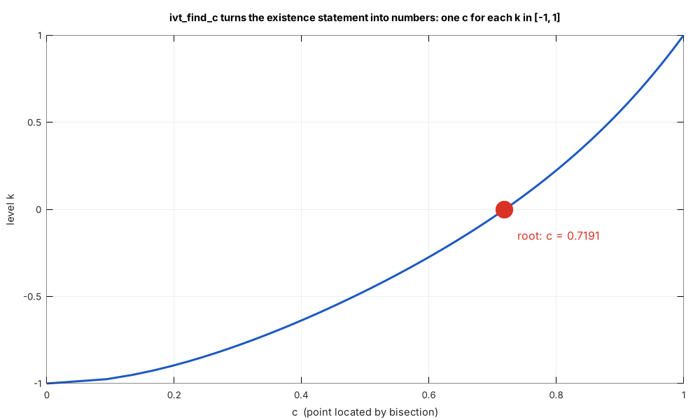
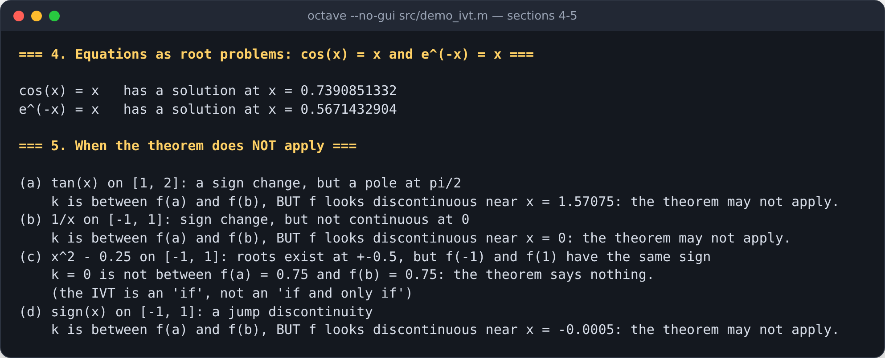
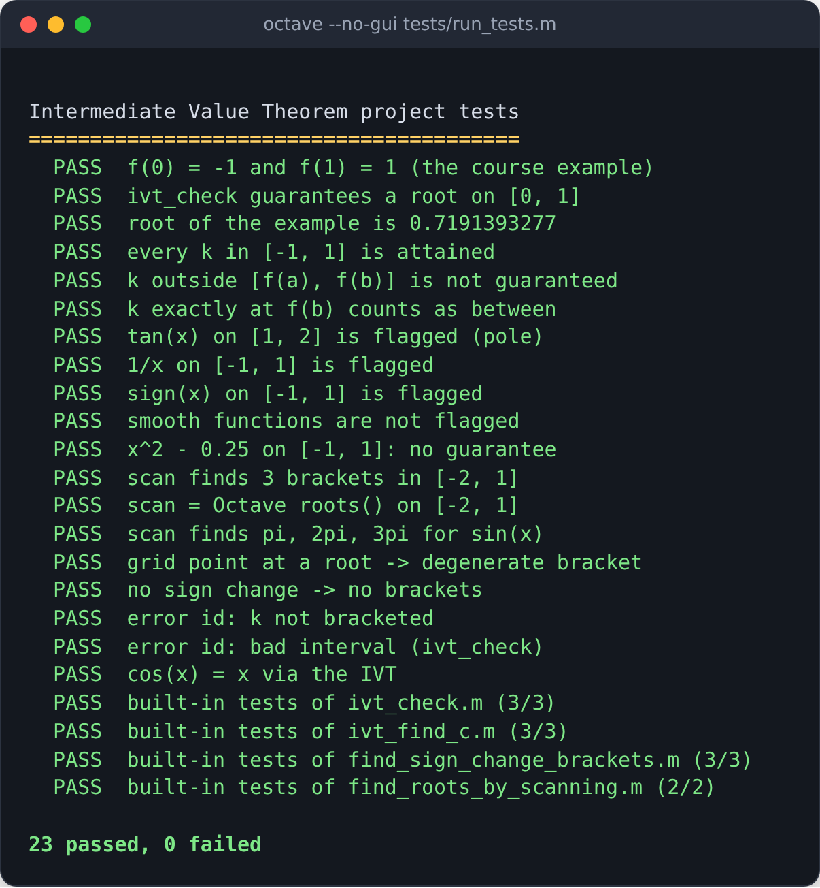
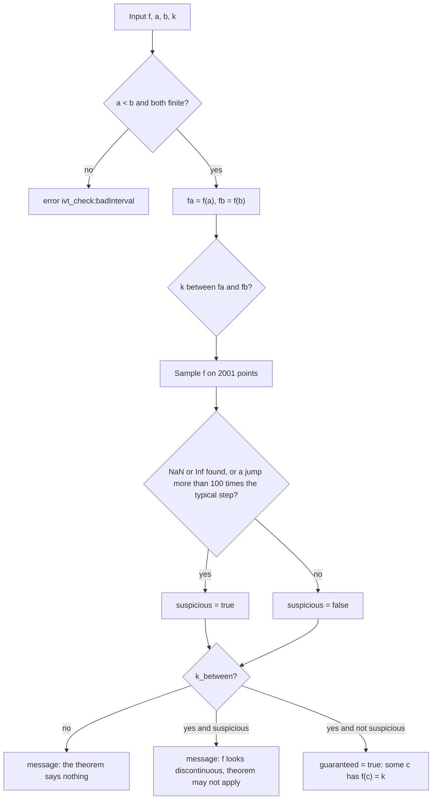
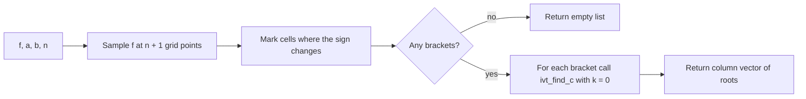

# Intermediate Value Theorem Root-Existence Checker (GNU Octave)

[](https://octave.org/)
[](LICENSE)
[](https://github.com/YOUR-USERNAME/intermediate-value-theorem-root-existence-checker-gnu-octave/actions/workflows/octave-tests.yml)


A small, well-tested **Intermediate Value Theorem (IVT)** toolkit for **GNU Octave**. It checks whether the theorem guarantees a root (or any other value $k$) on an interval, warns you when the function looks discontinuous and the theorem may not apply, finds the promised point $c$ with $f(c)=k$ by bisection, scans an interval for *every* sign change, and ships with a five-section demo, an automated test-suite and every plot used in this README.

> **Before you start:** the repository's `LICENSE` file contains the placeholder `[YOUR NAME]` as the copyright holder. Replace it with your own name before publishing.

---

## Table of contents

1. [Overview](#1-overview)
2. [Features](#2-features)
3. [Screenshot gallery](#3-screenshot-gallery)
4. [Theory](#4-theory)
5. [Algorithms](#5-algorithms)
6. [Project structure](#6-project-structure)
7. [Requirements and installation](#7-requirements-and-installation)
8. [Quick start](#8-quick-start)
9. [API reference](#9-api-reference)
10. [Worked examples with real output](#10-worked-examples-with-real-output)
11. [Code walkthrough](#11-code-walkthrough)
12. [Error analysis](#12-error-analysis)
13. [Edge cases and limitations](#13-edge-cases-and-limitations)
14. [Running the tests](#14-running-the-tests)
15. [Regenerating the images and sample output](#15-regenerating-the-images-and-sample-output)
16. [Exercises](#16-exercises)
17. [Extension ideas](#17-extension-ideas)
18. [Original notes and what changed](#18-original-notes-and-what-changed)
19. [FAQ](#19-faq)
20. [Glossary](#20-glossary)
21. [References](#21-references)
22. [Contributing](#22-contributing)
23. [License](#23-license)

---

## 1. Overview

The Intermediate Value Theorem says that a continuous function cannot get from one value to another without passing through everything in between. It is the reason a graph with no gaps that starts below the $x$-axis and ends above it must cross the axis somewhere.

It is also an **existence theorem**: it promises a point $c$ but does not say where it is. This project closes that gap in three steps:

1. **Check** the hypotheses the computer *can* check: does $k$ lie between $f(a)$ and $f(b)$, and does the function behave continuously on a sample of points? (`ivt_check`)
2. **Locate** the promised point with bisection, turning "there exists a $c$" into a number. (`ivt_find_c`)
3. **Search** a whole interval for every sign change, each of which traps a root by the same theorem. (`find_sign_change_brackets`, `find_roots_by_scanning`)

**Worked problem used throughout:**

$$f(x) = x^5 - 2x^3 + 3x^2 - 1, \qquad f(0) = -1 < 0 < 1 = f(1)$$

Because $f$ is a polynomial it is continuous, and $0$ lies between $f(0)$ and $f(1)$. The IVT therefore guarantees a root in $[0, 1]$. The code finds it: $c \approx 0.7191393277$.

The project also includes the **counter-examples** every student should see: $\tan x$ on $[1, 2]$ (a sign change caused by a pole), $1/x$ on $[-1, 1]$, a jump discontinuity, and $x^2 - 0.25$ (roots exist even though $f(a)$ and $f(b)$ have the same sign).

## 2. Features

- **`ivt_check(f, a, b, k)`** evaluates $f(a)$, $f(b)$, tests whether $k$ lies between them and samples $f$ on 2001 points to flag NaN/Inf values and suspicious jumps. It returns a struct with `k_between`, `suspicious`, `suspicious_at`, `guaranteed` and a one-sentence `message`.
- **`ivt_find_c(f, a, b, k, tol)`** finds a point $c$ with $f(c)=k$ by applying bisection to $g(x)=f(x)-k$, and reports iterations, residual and error bound.
- **`find_sign_change_brackets(f, a, b, n)`** splits $[a,b]$ into $n$ pieces (default 400) and returns every piece where $f$ changes sign. A grid point that is exactly a root is returned as a degenerate bracket $[x_i, x_i]$.
- **`find_roots_by_scanning(f, a, b, n, tol)`** combines the two: scan, then refine every bracket.
- **Honest about its limits:** a computer cannot prove continuity, so the check is labelled a heuristic and the message says "may not apply" rather than claiming certainty.
- **Defensive validation** with stable error identifiers: `ivt_check:badInterval`, `ivt_find_c:badInterval`, `ivt_find_c:notBracketed`, `find_sign_change_brackets:badInput`.
- **A five-section demo** (`demo_ivt`) with the course example, a table of attained levels, a scan of $[-2, 1]$, two equations solved as root problems and four counter-examples.
- **23 automated checks** (19 explicit tests plus the `%!test` blocks of all four functions), a GitHub Actions workflow and reproducible plot / sample-output scripts.
- **No toolboxes needed:** only core Octave.

## 3. Screenshot gallery

### Plots

![The curve f(x) = x^5 - 2x^3 + 3x^2 - 1 on [0, 1] with horizontal levels k = -0.5, 0 and 0.5 and the points c where the curve reaches each level](images/ivt-every-level-is-attained.png)

*Every level $k$ between $f(0)=-1$ and $f(1)=1$ is reached. The shaded band is the range $[f(0), f(1)]$. The dashed horizontal lines are the levels $k=-0.5$, $0.0$ and $0.5$, and the dotted verticals drop to the points $c = 0.4825$, $0.7191$ and $0.8833$ where the curve meets them.*



*`ivt_find_c` turns the existence statement into numbers: one $c$ for each $k \in [-1, 1]$. Plotting $k$ against $c$ redraws the same curve, with the root $c = 0.7191$ (the level $k=0$) highlighted.*

![Scan of the interval [-2, 1] for sign changes: green dots where f is positive, red dots where it is negative, orange bands where the sign changes and black diamonds at the three roots](images/ivt-sign-change-scan.png)

*Scanning $[-2, 1]$: green dots have $f>0$, red dots have $f<0$, orange bands are the sub-intervals where the sign flips, and black diamonds mark the three roots $x=-1.8595$, $-0.5074$ and $0.7191$.*

![Four panels: tan(x) on [1, 2] with a pole, 1/x on [-1, 1], a step function that skips the level 0.4, and x^2 - 0.25 whose two roots exist although f(-1) and f(1) have the same sign](images/ivt-when-it-does-not-apply.png)

*When the theorem does not apply, or says nothing. Top left: $\tan x$ changes sign on $[1, 2]$ only because of a pole at $\pi/2$. Top right: $1/x$ is not continuous at $0$. Bottom left: a step function skips every value between $-1$ and $1$, so $k=0.4$ is never attained. Bottom right: $x^2-0.25$ has roots at $\pm 0.5$ although $f(-1)=f(1)>0$, so the IVT is an "if", not an "if and only if".*

### Terminal screenshots

![Terminal: demo sections 1 to 3, the course example, attained levels and the scan of [-2, 1]](images/terminal-ivt-example-and-scan.png)

*`octave --no-gui src/demo_ivt.m`, sections 1-3: the course example, the table of attained levels with the out-of-range $k=1.5$ message, and the three brackets found in $[-2, 1]$ compared with Octave's `roots()`.*



*Sections 4-5: $\cos x = x$ and $e^{-x}=x$ solved as root problems, then the four warnings and "says nothing" messages.*



*The test-suite: 23 passed, 0 failed.*

## 4. Theory

### 4.1 The Intermediate Value Theorem

> **Theorem (IVT).** If $f$ is continuous on the closed interval $[a, b]$ and $k$ is any number between $f(a)$ and $f(b)$, then there is at least one $c \in [a, b]$ with $f(c) = k$.

**Special case (Bolzano's theorem).** If $f$ is continuous on $[a,b]$ and $f(a)\,f(b) < 0$, then $f$ has a root in $(a, b)$. This is the case $k = 0$ and it is the one used for root-finding.

### 4.2 Why it is true (sketch)

Assume $f(a) < k < f(b)$ and let

$$S = \{\, x \in [a,b] : f(x) < k \,\}, \qquad c = \sup S .$$

$S$ is non-empty ($a \in S$) and bounded, so $c$ exists. If $f(c) < k$, continuity would keep $f < k$ slightly to the right of $c$, contradicting that $c$ is an upper bound of $S$. If $f(c) > k$, continuity would keep $f > k$ slightly to the left of $c$, so a smaller number would already be an upper bound. Hence $f(c) = k$. The argument uses two things and nothing else: **continuity** and the **completeness of the real numbers** (the supremum exists).

### 4.3 Continuity is essential

If $f$ is not continuous the conclusion can fail:

$$f(x) = \begin{cases} -1 & x < 0 \\ \ \ 1 & x \ge 0 \end{cases}$$

has $f(-1) = -1$ and $f(1) = 1$ but never takes the value $0.4$ (bottom-left panel of the fourth plot). A pole is an even more deceptive case: $\tan x$ has $\tan 1 \approx 1.56 > 0$ and $\tan 2 \approx -2.19 < 0$, yet $\tan x \ne 0$ everywhere on $[1, 2]$, because the sign change happens through the pole at $\pi/2$.

### 4.4 The converse is false

The theorem is an implication, not an equivalence. $f(x) = x^2 - 0.25$ has roots at $\pm 0.5$, but on $[-1, 1]$ we have $f(-1) = f(1) = 0.75$, so $k=0$ is not between the end values and the theorem *says nothing*. Likewise, a sign change over $[a,b]$ tells you there is *an odd number* of roots (counted with multiplicity) inside, not exactly one: the scan in section 10 finds three roots of the same quintic in $[-2, 1]$.

### 4.5 Solving equations with the IVT

To show that $g(x) = h(x)$ has a solution, apply the theorem to $f = g - h$.

* $\cos x = x$: take $f(x) = \cos x - x$. Then $f(0) = 1 > 0$ and $f(1) = \cos 1 - 1 < 0$, so a solution lies in $[0, 1]$.
* $e^{-x} = x$: take $f(x) = e^{-x} - x$. Then $f(0) = 1 > 0$ and $f(1) = e^{-1} - 1 < 0$, so a solution lies in $[0, 1]$.

The demo then locates both: $0.7390851332$ and $0.5671432904$.

A related consequence: every continuous $g : [a,b] \to [a,b]$ has a fixed point, because $f(x) = g(x) - x$ satisfies $f(a) \ge 0 \ge f(b)$.

### 4.6 From existence to a number: bisection

Bisection is the IVT applied over and over. With $g(x) = f(x) - k$ and $g(a)\,g(b) < 0$, the midpoint $m = a + (b-a)/2$ satisfies exactly one of $g(m) = 0$, $g(a)\,g(m) < 0$ or $g(m)\,g(b) < 0$. In the last two cases the IVT guarantees a solution in the half with the sign change. After $j$ halvings the bracket has width $(b - a)/2^j$.

### 4.7 Scanning for all sign changes

Choose $n$ and the grid $x_i = a + i\,(b-a)/n$. Every cell $[x_i, x_{i+1}]$ with $f(x_i)\,f(x_{i+1}) < 0$ contains a root by Bolzano's theorem. Cells with no sign change *might* still contain two roots or a touching root; the IVT cannot detect these, and neither can the scan (see section 13).

## 5. Algorithms

### 5.1 `ivt_check` (hypothesis check)

```text
function ivt_check(f, a, b, k = 0)
    require finite scalars with a < b
    fa <- f(a);  fb <- f(b)
    k_between <- min(fa, fb) <= k <= max(fa, fb)

    x <- 2001 equally spaced points on [a, b]
    y <- f(x)
    if any y is NaN or Inf:
        suspicious <- true;  suspicious_at <- first such x
    else:
        d <- |diff(y)|
        typical <- median(d)
        dmax <- max(d) at position i
        if dmax > 100 * max(typical, eps)  and  dmax > 1e-3 * max(1, max|y|):
            suspicious <- true;  suspicious_at <- midpoint of cell i
    guaranteed <- k_between and not suspicious
    return struct(fa, fb, k, k_between, suspicious, suspicious_at, guaranteed, message)
```



### 5.2 `ivt_find_c` (locate the promised point)

```text
function ivt_find_c(f, a, b, k = 0, tol = 1e-10)
    g(x) <- f(x) - k
    if g(a) * g(b) > 0: error "k is not between f(a) and f(b)"
    if g(a) = 0: return a
    if g(b) = 0: return b
    while (b - a) / 2 > tol:
        c <- a + (b - a) / 2
        if g(c) = 0: stop
        if g(a) * g(c) < 0: b <- c   else: a <- c
    return a + (b - a) / 2
```

### 5.3 Scan and refine

```text
function find_sign_change_brackets(f, a, b, n = 400)
    x <- n + 1 equally spaced points;  y <- f(x)
    for i = 1 .. n:
        if y(i) = 0:                                   add [x(i), x(i)]
        else if y(i) * y(i+1) < 0 or (y(i+1) = 0 and i = n):   add [x(i), x(i+1)]

function find_roots_by_scanning(f, a, b, n, tol = 1e-12)
    for each bracket:  degenerate -> its point;  otherwise ivt_find_c(f, left, right, 0, tol)
```



## 6. Project structure

```text
intermediate-value-theorem-root-existence-checker-gnu-octave/
├── README.md
├── LICENSE                          MIT (replace [YOUR NAME])
├── .gitignore
├── .gitattributes                   *.m is shown as MATLAB/Octave on GitHub
├── .github/workflows/
│   └── octave-tests.yml             runs the test-suite on every push / pull request
├── src/
│   ├── ivt_check.m                  hypothesis check with discontinuity heuristic
│   ├── ivt_find_c.m                 locate c with f(c) = k by bisection
│   ├── find_sign_change_brackets.m  grid scan for sign changes
│   ├── find_roots_by_scanning.m     scan + refine all roots
│   └── demo_ivt.m                   five-section demonstration
├── tests/
│   └── run_tests.m                  self-checking test-suite (exit status 1 on failure)
├── scripts/
│   ├── generate_images.m            re-creates the four plots in images/
│   ├── save_figure.m                helper used by generate_images.m
│   └── capture_sample_output.sh     re-creates docs/sample-output/*.txt
├── images/                          4 plots + 3 terminal screenshots used in this README
└── docs/
    ├── original-notes/
    │   └── intermediate-value-theorem.pdf    the original course note (theory only)
    └── sample-output/
        ├── demo-ivt.txt             captured output of the demo
        └── test-results.txt         captured output of the test-suite
```

## 7. Requirements and installation

| Requirement | Notes |
|---|---|
| GNU Octave | Developed and tested with **Octave 8.4**. Only core functions are used (for example `linspace`, `median`, `roots`); no packages to install. |
| A terminal or the Octave GUI | The demo and tests also run headless with `--no-gui`. |

**Install Octave**

* **Windows:** download the installer from <https://octave.org/download>.
* **macOS:** for example `brew install octave` (Homebrew), or an installer from <https://octave.org/download>.
* **Linux (Debian/Ubuntu):** `sudo apt-get install octave`. This is the command the CI workflow uses.

**Get the code**

```bash
git clone https://github.com/YOUR-USERNAME/intermediate-value-theorem-root-existence-checker-gnu-octave.git
cd intermediate-value-theorem-root-existence-checker-gnu-octave
```

**Use it from Octave**

```octave
addpath("src")      % run once per session, from the project root
```

## 8. Quick start

```octave
addpath("src")
f = @(x) x.^5 - 2*x.^3 + 3*x.^2 - 1;   % use .^ so that f works on vectors

r = ivt_check(f, 0, 1);                % does the IVT guarantee a root?
disp(r.message)
% f(a) = -1 and f(b) = 1 bracket k = 0: some c in [0, 1] has f(c) = 0.

c = ivt_find_c(f, 0, 1)                % the root:       c = 0.7191393277
c = ivt_find_c(f, 0, 1, 0.5)           % where f(c) = 0.5: c = 0.8833

roots_found = find_roots_by_scanning(f, -2, 1)'   % all three real roots
```

Run the full demo or the tests from the project root:

```bash
octave --no-gui src/demo_ivt.m
octave --no-gui tests/run_tests.m
```

> **Important:** every function evaluates `f` on a *vector* of points. Write `x.^2`, `x.*y` and `1./x`, not `x^2`, `x*y` and `1/x`.

## 9. API reference

### 9.1 `ivt_check`

```octave
result = ivt_check(f, a, b)        % k = 0
result = ivt_check(f, a, b, k)
```

| Input | Meaning |
|---|---|
| `f` | vectorised function handle |
| `a`, `b` | finite real scalars with `a < b` |
| `k` | level to test (default `0`; an empty value also means `0`) |

| Output field | Meaning |
|---|---|
| `fa`, `fb`, `k` | the three numbers involved |
| `k_between` | `true` if `min(f(a), f(b)) <= k <= max(f(a), f(b))` (end points count) |
| `suspicious` | `true` if the 2001-point sample contained NaN/Inf or a jump larger than 100 times the median step (and larger than $10^{-3}\max(1, \max\lvert y\rvert)$) |
| `suspicious_at` | location of the first non-finite value or of the largest jump (`NaN` if none) |
| `guaranteed` | `k_between && ! suspicious` |
| `message` | one-sentence conclusion |

**Errors:** `ivt_check:badInterval` if `a`/`b` are not finite scalars with `a < b`. Calling with fewer than three arguments prints the usage text.

### 9.2 `ivt_find_c`

```octave
c = ivt_find_c(f, a, b)
[c, info] = ivt_find_c(f, a, b, k, tol)
```

| Input | Meaning |
|---|---|
| `k` | target value (default `0`) |
| `tol` | tolerance on the half-width of the final bracket (default `1e-10`) |

| Output | Meaning |
|---|---|
| `c` | a point in `[a, b]` with `f(c) = k` to within the tolerance |
| `info.iterations` | number of halving steps (`0` if an end point already satisfies `f = k`) |
| `info.residual` | $\lvert f(c) - k\rvert$ |
| `info.error_bound` | half-width of the final bracket |

**Errors:** `ivt_find_c:badInterval` (need `a < b`); `ivt_find_c:notBracketed` (`k` is not between `f(a)` and `f(b)`, so the theorem gives no guarantee).

**Note:** the function returns *one* point. If `f(a) = k` it returns `a` immediately even when other solutions exist.

### 9.3 `find_sign_change_brackets`

```octave
brackets = find_sign_change_brackets(f, a, b)
brackets = find_sign_change_brackets(f, a, b, n)     % n = number of cells, default 400
```

Returns an $m \times 2$ matrix with one `[left right]` row per bracket (a $0 \times 2$ matrix if there is none). A grid point where `f` is exactly zero gives a degenerate row `[x_i x_i]`.

**Errors:** `find_sign_change_brackets:badInput` unless `a < b` and `n` is a whole number $\ge 1$.

### 9.4 `find_roots_by_scanning`

```octave
r = find_roots_by_scanning(f, a, b)
r = find_roots_by_scanning(f, a, b, n, tol)     % tol default 1e-12
```

Returns a column vector of roots, one per bracket (degenerate brackets contribute their grid point directly).

## 10. Worked examples with real output

The text below is copied from [`docs/sample-output/demo-ivt.txt`](docs/sample-output/demo-ivt.txt), produced by `octave --no-gui src/demo_ivt.m` with Octave 8.4.

### 10.1 The course example

```text
=== 1. The example from the notes: f(x) = x^5 - 2x^3 + 3x^2 - 1 on [0, 1] ===

f(0) = -1
f(1) = 1

f(a) = -1 and f(b) = 1 bracket k = 0: some c in [0, 1] has f(c) = 0.
root found by bisection: c = 0.7191393277   (|f(c)| = 1.47e-10, 33 iterations)
```

### 10.2 Every value in between is attained

```text
=== 2. Every value between f(0) = -1 and f(1) = 1 is attained ===

       k              c           f(c)
   -0.90   0.1954976696  -0.9000000000
   -0.50   0.4825499567  -0.5000000001
    0.00   0.7191393277  -0.0000000001
    0.50   0.8832936212   0.5000000000
    0.90   0.9794208647   0.8999999998

k = 1.5 lies outside [-1, 1]:
  k = 1.5 is not between f(a) = -1 and f(b) = 1: the theorem says nothing.
```

The small differences from $k$ in the last column (for instance $-0.5000000001$) are the bisection tolerance showing through.

### 10.3 Finding every root in $[-2, 1]$

```text
=== 3. Scanning [-2, 1] for every sign change ===

3 brackets found
bracket                            root
[-1.8600, -1.8500]      -1.859515601282
[-0.5100, -0.5000]      -0.507400610686
[ 0.7100,  0.7200]       0.719139327761

Octave's roots() finds these real roots: -1.859515601282 -0.507400610687 0.719139327760 
```

The scan agrees with Octave's polynomial solver `roots()` to about $10^{-12}$. (The brackets in this demo come from a 300-cell scan; the root values come from `find_roots_by_scanning` with its default grid.)

### 10.4 Equations as root problems

```text
=== 4. Equations as root problems: cos(x) = x and e^(-x) = x ===

cos(x) = x   has a solution at x = 0.7390851332
e^(-x) = x   has a solution at x = 0.5671432904
```

### 10.5 When the theorem does not apply

```text
=== 5. When the theorem does NOT apply ===

(a) tan(x) on [1, 2]: a sign change, but a pole at pi/2
    k is between f(a) and f(b), BUT f looks discontinuous near x = 1.57075: the theorem may not apply.
(b) 1/x on [-1, 1]: sign change, but not continuous at 0
    k is between f(a) and f(b), BUT f looks discontinuous near x = 0: the theorem may not apply.
(c) x^2 - 0.25 on [-1, 1]: roots exist at +-0.5, but f(-1) and f(1) have the same sign
    k = 0 is not between f(a) = 0.75 and f(b) = 0.75: the theorem says nothing.
    (the IVT is an 'if', not an 'if and only if')
(d) sign(x) on [-1, 1]: a jump discontinuity
    k is between f(a) and f(b), BUT f looks discontinuous near x = -0.0005: the theorem may not apply.
```

The four cases show three different outcomes: *theorem may not apply* because of a discontinuity (a, b, d), and *theorem says nothing* because the hypothesis on $k$ fails (c).

### 10.6 The test-suite

```text
Intermediate Value Theorem project tests
========================================
  PASS  f(0) = -1 and f(1) = 1 (the course example)
  PASS  ivt_check guarantees a root on [0, 1]
  PASS  root of the example is 0.7191393277
  PASS  every k in [-1, 1] is attained
  PASS  k outside [f(a), f(b)] is not guaranteed
  PASS  k exactly at f(b) counts as between
  PASS  tan(x) on [1, 2] is flagged (pole)
  PASS  1/x on [-1, 1] is flagged
  PASS  sign(x) on [-1, 1] is flagged
  PASS  smooth functions are not flagged
  PASS  x^2 - 0.25 on [-1, 1]: no guarantee
  PASS  scan finds 3 brackets in [-2, 1]
  PASS  scan = Octave roots() on [-2, 1]
  PASS  scan finds pi, 2pi, 3pi for sin(x)
  PASS  grid point at a root -> degenerate bracket
  PASS  no sign change -> no brackets
  PASS  error id: k not bracketed
  PASS  error id: bad interval (ivt_check)
  PASS  cos(x) = x via the IVT
  PASS  built-in tests of ivt_check.m (3/3)
  PASS  built-in tests of ivt_find_c.m (3/3)
  PASS  built-in tests of find_sign_change_brackets.m (3/3)
  PASS  built-in tests of find_roots_by_scanning.m (2/2)

23 passed, 0 failed
```

## 11. Code walkthrough

### 11.1 `ivt_check.m`

* **Step 1: the part that is provable.** `fa = f(a); fb = f(b); k_between = (min(fa, fb) <= k) && (k <= max(fa, fb));` is the exact hypothesis on $k$. The comparison is non-strict, so $k = f(b)$ counts as "between" (there is a test for this).
* **Step 2: the part that is only a screen.** `x = linspace(a, b, 2001); y = f(x);` samples the function. If any value is `NaN` or `Inf` the function is flagged immediately at the first offending $x$ (this is what catches a pole that is hit exactly, such as $1/x$ at $0$).
* **Step 3: jump detection.** Otherwise the successive differences `d = abs(diff(y))` are compared with their median. A continuous function sampled finely changes by roughly the same amount between neighbours, so a single difference more than 100 times the median (and not negligible in absolute terms: more than $10^{-3}\max(1, \max|y|)$) looks like a pole or a jump. The reported location is the midpoint of the offending cell.
* **Step 4: the verdict.** `guaranteed = k_between && ! suspicious`, and one of three messages is built: *says nothing*, *may not apply*, or *some c has f(c) = k*.

The messages are deliberately cautious: "may not apply", not "does not apply".

### 11.2 `ivt_find_c.m`

It builds `g = @(x) f(x) - k`, checks `sign(ga) * sign(gb) > 0` (same sign means no guarantee, hence the `notBracketed` error), handles an exact zero at an end point, and then bisects:

```octave
while (b - a) / 2 > tol
  iterations += 1;
  c = a + (b - a) / 2;          % midpoint, safe against overflow
  gc = g(c);
  if gc == 0, break; end
  if sign(ga) * sign(gc) < 0
    b = c;  gb = gc;            % solution in the left half
  else
    a = c;  ga = gc;            % solution in the right half
  end
end
c = a + (b - a) / 2;
```

Using `sign(ga) * sign(gc)` instead of `ga * gc` avoids overflow or underflow of the product.

### 11.3 `find_sign_change_brackets.m`

It evaluates `y = f(x)` once on the grid and loops over the cells. The `y(i) == 0` branch records an exact grid-point root as a degenerate bracket; the second branch records a sign change. The extra clause `(y(i + 1) == 0 && i == n)` catches a root exactly at the right end point $b$, which would otherwise never be the *left* end of a cell.

### 11.4 `find_roots_by_scanning.m`

A thin composition: scan, then call `ivt_find_c(f, left, right, 0, tol)` on each non-degenerate bracket with the tighter default `tol = 1e-12`.

### 11.5 Test design

`tests/run_tests.m` starts with `1;` (so Octave treats it as a script that defines helper functions), defines `run_case` which counts passes and failures, and ends with `exit(1)` if anything failed so that CI turns red. It also reruns the `%!test` blocks embedded in each source file through `test(name, "quiet")`.

## 12. Error analysis

### 12.1 Accuracy of `ivt_find_c`

After $j$ halving steps the bracket has width $(b-a)/2^{j}$, and the loop stops as soon as its half-width is at most `tol`:

$$\frac{b-a}{2^{\,j+1}} \le \text{tol} \quad\Longrightarrow\quad j = \left\lceil \log_2\frac{b-a}{\text{tol}} \right\rceil - 1 .$$

This formula reproduces every iteration count seen in this project:

| Problem | $b - a$ | tol | $\lceil \log_2((b-a)/\text{tol}) \rceil - 1$ | reported `iterations` |
|---|---|---|---|---|
| course quintic, $k=0$ on $[0,1]$ | 1 | $10^{-10}$ | 33 | 33 (demo output above) |
| $x^2 = 4$ on $[0,3]$ | 3 | $10^{-10}$ | 34 | 34 |
| $x^3 - x - 2 = 0$ on $[1,2]$ | 1 | $10^{-7}$ | 23 | 23 |

The error in $c$ is at most the final half-width. The *residual* $|f(c) - k|$ is roughly that error multiplied by the local slope $|f'(c)|$. For the course example $f'(0.7191) \approx 2.55$ and the final half-width is $2^{-34} \approx 5.8\times10^{-11}$, which accounts for the reported residual $1.47\times10^{-10}$.

### 12.2 Accuracy of the scan

Each bracket has width $(b-a)/n$. In the demo $(1-(-2))/300 = 0.01$, which is exactly the width of the three brackets printed in section 10.3. Refinement by bisection then reduces that to the tolerance. The *reliability* of the scan is a separate question: it finds only roots at which the sign changes **between two adjacent grid points**.

### 12.3 Accuracy of the continuity screen

`ivt_check` tests 2001 points, so it distinguishes jumps and poles whose size is large compared with the typical step. It has false positives and false negatives; see the next section.

## 13. Edge cases and limitations

* **Continuity cannot be proved numerically.** `ivt_check` is a *heuristic* screen. `guaranteed = true` means "the end-point test passed and nothing looked wrong on 2001 sample points", not "this is a proof".
* **False positive:** a continuous but extremely steep function can be flagged. For example `tanh(1000*x)` on $[-1, 1]$ is reported suspicious at $x=-0.0005$, because its step-to-step change near $0$ dwarfs the median.
* **False negative:** a small jump on top of a smooth function is not seen. For example `sign(x)*1e-9 + x` on $[-1, 1]$ (a jump of $2\times10^{-9}$) is *not* flagged.
* **Poles hit exactly are caught by the non-finite check.** `1./x` on $[-1, 1]$ evaluates to `Inf` at $x=0$ because the 2001-point grid contains $0$, so it is flagged at once. A pole that falls between sample points is only caught if the jump test notices it (as for $\tan x$ near $\pi/2$).
* **Tangential ("touching") roots are invisible to a sign scan.** $x^2$ never changes sign. The scan finds the root at $0$ on $[-1, 1]$ with `n = 400` *only because that grid happens to contain $x=0$ exactly*; with `n = 399` it returns no bracket at all. Do not rely on this.
* **Two roots in one cell cancel out.** If two roots lie inside the same cell the sign is the same at both ends and nothing is reported. Whether a close pair is resolved depends on where the grid points fall (for example `(x-0.5).^2 - 1e-12`, with roots $2\times10^{-6}$ apart, is reported as two brackets on $[0, 1]$ with `n = 10`, because the grid point $x=0.5$ lies between the two roots). A finer grid helps, but there is no guarantee.
* **A pole is mistaken for a root by the scan.** `find_roots_by_scanning(@(x) tan(x), 1, 2)` returns $1.5707963268$ ($\pi/2$) although $|\tan x|$ there is about $2.9\times10^{12}$. The scan only looks at signs. Use `ivt_check` first, or check `abs(f(r))` afterwards.
* **`ivt_find_c` returns one point,** not all solutions, and with $k = f(a)$ it returns `a` without looking further.
* **Vectorisation is required.** `f` must accept a vector. A function written as `@(x) x^2` fails; write `@(x) x.^2`.
* **Real intervals only.** Complex roots are out of scope.
* **Function evaluation errors.** If `f(a)` or `f(b)` is `NaN`, `k_between` is `false` (comparisons with `NaN` are false) and the message says the theorem says nothing.

## 14. Running the tests

From the project root:

```bash
octave --no-gui tests/run_tests.m
```

The exit status is `0` when every check passes and `1` otherwise. The same command runs in GitHub Actions through `.github/workflows/octave-tests.yml` (Ubuntu, `apt-get install octave`). The expected output is shown in [section 10.6](#106-the-test-suite) and saved in `docs/sample-output/test-results.txt`.

To run only the embedded `%!test` blocks of one file from within Octave:

```octave
addpath("src")
test ivt_check
test ivt_find_c
test find_sign_change_brackets
test find_roots_by_scanning
```

## 15. Regenerating the images and sample output

**Plots** (the four PNGs showing curves):

```bash
octave --no-gui scripts/generate_images.m
```

It uses `scripts/save_figure.m`, which selects the anti-aliased `-dpngcairo` driver when the gnuplot toolkit is active and `-dpng` otherwise, and runs without a display.

**Plain-text sample output:**

```bash
bash scripts/capture_sample_output.sh
```

This re-creates `docs/sample-output/demo-ivt.txt` and `docs/sample-output/test-results.txt`.

**Terminal screenshots** (`images/terminal-*.png`) were rendered from those two text files with an external helper that is not part of this repository. If you change the demo, regenerate the text files and re-capture the screenshots with a terminal of your choice.

## 16. Exercises

1. Use `ivt_check` to confirm that $f(x) = x^3 - x - 2$ has a root in $[1, 2]$, then find it with `ivt_find_c`. Compare the iteration count with the formula in section 12.1.
2. Show with the IVT that $x = \cos x$ has a solution in $[0, 1]$ (section 4.5), then check the number from the demo with `cos(0.7390851332) - 0.7390851332`.
3. Call `ivt_find_c(f, 0, 1, 1.5)` for the course quintic. Which error identifier is raised, and why does the theorem not apply?
4. Predict, then check with `ivt_check`, what the message says for $f(x) = 1/x$ on $[1, 2]$. Is $k=0$ between the end values? Does this function have a root there?
5. Find three different functions that satisfy $f(a)\,f(b) > 0$ yet have a root in $[a, b]$.
6. Run `find_sign_change_brackets(@(x) sin(x), 0, 10, 1000)`. Which roots of $\sin$ lie in $[0, 10]$, and how does the scan report the one at $x=0$? (The test-suite checks $\pi, 2\pi, 3\pi$ on $[1, 10]$.)
7. Change `n` in the scan of $[-2, 1]$ from 400 to 10. Which brackets appear or vanish, and why?
8. Try `ivt_check(@(x) tanh(1000*x), -1, 1)`. Why is the answer a false alarm? Change the thresholds in `ivt_check.m` to make it pass, and check that the pole examples are still flagged.
9. Use the IVT (not a program) to prove that every polynomial of odd degree has a real root. Then confirm numerically for $x^3 + 2x - 1$.
10. The step function in section 4.3 violates continuity. Which of the four functions in this package would notice it, and at which $x$?

## 17. Extension ideas

* Replace the median-based jump test with a *local* test that compares successive differences to their neighbours, or with a Lipschitz-style estimate, and measure false-positive and false-negative rates on a suite of functions.
* Add **adaptive scanning**: refine cells where $|f|$ is small or where the curvature suggests a hidden pair of roots.
* Detect tangential roots by scanning for sign changes of $f'$ (using a numerical derivative) and testing $|f|$ at those points.
* Add a **pole filter** to `find_roots_by_scanning` that rejects brackets where $|f(c)|$ stays large after refinement.
* Combine with Brent's method or `fzero` for faster refinement and compare iteration counts against bisection.
* Add a plot function that draws any $f$, its sign-change bands and the located roots (the scan plot in this README is the template).
* Extend to systems: the multidimensional analogue is the Poincaré–Miranda theorem.
* Write a version for integer or rational arithmetic to give a proof-grade bisection.

## 18. Original notes and what changed

This project began as a single page of course notes, kept unchanged in [`docs/original-notes/intermediate-value-theorem.pdf`](docs/original-notes/intermediate-value-theorem.pdf). It is a short chat-style export (it carries a "Powered by AI" header) that:

1. states the Intermediate Value Theorem;
2. takes $f(x) = x^5 - 2x^3 + 3x^2 - 1$ and computes $f(0) = -1$ and $f(1) = 1$;
3. concludes that the equation $f(x) = 0$ has at least one root in $[0, 1]$.

I checked these claims: $f(0) = -1$, $f(1) = 1$, and the conclusion is correct (the root is $0.7191393277$). The notes contain **theory and a hand calculation only**: there was **no code** in them.

**Everything else in this repository is an addition:**

* the four functions in `src/` and their error handling;
* the discontinuity screen and its honest limitations;
* the scan for all sign changes and the comparison with Octave's `roots()`;
* the $\cos x = x$ and $e^{-x} = x$ examples and the four counter-examples;
* the 23-check test-suite and the CI workflow;
* the plots, terminal screenshots and this README.

## 19. FAQ

**Does `guaranteed = true` prove that a root exists?**
No. It says the end-point condition holds and the function looked continuous on 2001 samples. A proof needs continuity, which you establish mathematically (a polynomial, sine, exponential etc. is continuous everywhere).

**Why does `ivt_check` not simply test continuity?**
Continuity is a statement about infinitely many points and arbitrarily small scales. No finite sampling can prove it, so the code reports what it saw and words the result carefully.

**The sign changes but no root exists. How can that be?**
The function is not continuous: a pole (like $\tan x$ at $\pi/2$) or a jump. This is exactly what sections 4.3 and 10.5 demonstrate.

**$f(a)$ and $f(b)$ have the same sign. Is there no root?**
Not necessarily. The theorem gives no information in that case ($x^2 - 0.25$ on $[-1,1]$ has two roots).

**How many roots does a sign change guarantee?**
At least one; in total an odd number counting multiplicity.

**Why does `ivt_find_c` report an error instead of returning `NaN`?**
If $k$ is not between $f(a)$ and $f(b)$, the theorem provides no point to find. An explicit `ivt_find_c:notBracketed` error is easier to handle than a silent `NaN`.

**Why is my function failing with an "operator" or "nonconformant" error?**
It is not vectorised. Use `.^`, `.*`, `./`.

**Can I find all solutions of $f(x) = k$?**
Use `find_roots_by_scanning(@(x) f(x) - k, a, b)`.

**Which tolerance should I use?**
The defaults (`1e-10` for `ivt_find_c`, `1e-12` for the scan) are fine for double-precision demonstrations. Going far below about $10^{-15}$ times the size of the root is pointless because of rounding.

## 20. Glossary

| Term | Meaning |
|---|---|
| **Intermediate Value Theorem (IVT)** | A continuous function on $[a,b]$ takes every value between $f(a)$ and $f(b)$. |
| **Bolzano's theorem** | The special case $k=0$: a sign change of a continuous function implies a root. |
| **Continuous** | Roughly: the graph has no gaps, jumps or poles on the interval. |
| **Bracket** | An interval $[l, r]$ with $f(l)\,f(r) < 0$ (opposite signs at the ends). |
| **Degenerate bracket** | A bracket with $l = r$, used when a grid point is exactly a root. |
| **Root / zero** | A number $x$ with $f(x) = 0$. |
| **Pole** | A point where $\lvert f\rvert \to \infty$, such as $\tan x$ at $\pi/2$. |
| **Jump discontinuity** | A point where the left and right limits differ. |
| **Bisection** | Repeatedly halving a bracket while keeping the half with the sign change. |
| **Residual** | $\lvert f(c) - k\rvert$ at the computed point. |
| **Heuristic** | A rule of thumb that is usually right but carries no guarantee. |
| **Tangential root** | A root where the graph touches zero without crossing, such as $x^2$ at $0$. |

## 21. References

* J. Stewart, *Calculus*, section on continuity and the Intermediate Value Theorem.
* W. Rudin, *Principles of Mathematical Analysis*, chapter 4 (Continuity), for the formal proof via the supremum.
* R. L. Burden and J. D. Faires, *Numerical Analysis*, chapter on solutions of equations in one variable (bisection method).
* B. Bolzano (1817), the first purely analytic proof of the theorem now called Bolzano's theorem.
* GNU Octave documentation: <https://docs.octave.org/>.

## 22. Contributing

Issues and pull requests are welcome. Before opening a pull request:

1. Run `octave --no-gui tests/run_tests.m` and make sure it prints `0 failed`.
2. Add a test (in `tests/run_tests.m` or as a `%!test` block) for any new behaviour.
3. If you change the demo or a plot, regenerate `docs/sample-output/` and `images/` and update the affected text in this README.
4. Keep functions documented with a leading comment block, as in the existing files.

## 23. License

Released under the MIT License. See [`LICENSE`](LICENSE).
